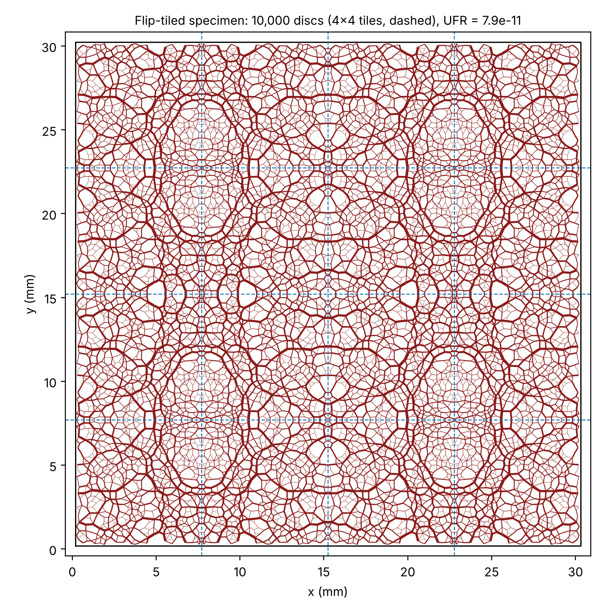
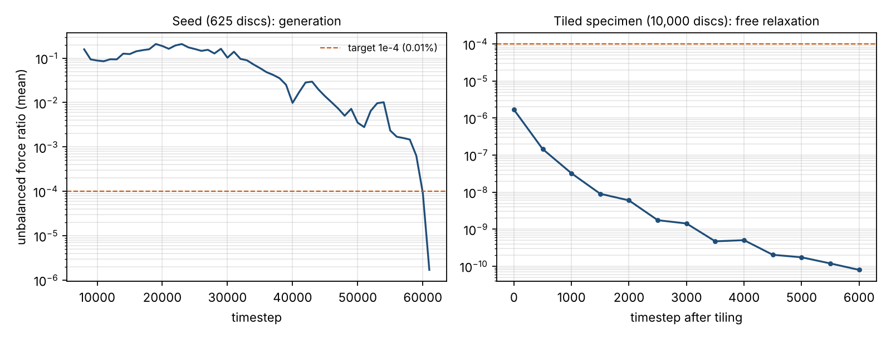
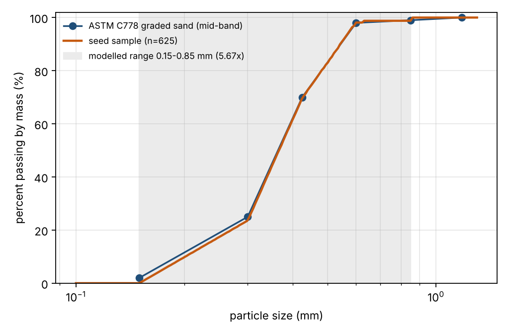

# DEM Specimen Generation for Granular Materials: flip tiling to 10,000 particles

Research project under Prof. Arghya Das, IIT Kanpur (Aug 2026 – ongoing).

Generating a large, dense, force-equilibrated sand specimen directly in DEM is slow: tens of
thousands of particles have to be packed and then cycled until every one of them is in equilibrium.
This repo does it differently:

1. Build a **small seed** (625 discs) whose sizes follow a **real sand grading curve** spanning
   **5.7x** from finest to coarsest, compress it isotropically to 100 kPa, and cycle it until it is
   in **force equilibrium** (unbalanced force ratio at or below 0.01%).
2. **Flip-tile** the seed 4 x 4 (mirror copies) into a **10,000-particle specimen**. Because the
   seed's walls are frictionless and twice as stiff as a disc contact, every wall contact turns into a
   disc-to-mirror-image contact carrying exactly the same force. **Contact-force chains run straight
   across tile boundaries** and the big specimen starts in equilibrium.
3. **Validate** the 10,000-particle specimen two ways. First, run it through the dynamic DEM again
   and check that nothing moves. Second, recompute force balance from the saved files with an
   independent checker that shares no code with the solver.



## Results (`python scripts/run_pipeline.py`, about 45 s)

| Quantity | Seed | Tiled specimen |
| --- | --- | --- |
| Particles | 625 | **10,000** (4 x 4 tiles) |
| Size range | 0.15–0.85 mm (**5.67x**), D50 = 0.37 mm by mass | same |
| Porosity / void ratio | 0.176 / 0.214 | 0.176 / 0.214 |
| Mean coordination number (non-rattlers) | 3.73 | 3.73 |
| Wall stresses (kPa) | 100.2, 100.2, 99.7, 99.7 | 100.2, 100.2, 99.7, 99.7 |
| Unbalanced force ratio, mean | **1.7 x 10⁻⁶** (target ≤ 10⁻⁴ = 0.01%) | **1.7 x 10⁻⁶** right after tiling, **7.9 x 10⁻¹¹** after 6,000 more steps |
| Unbalanced force ratio, max | 1.9 x 10⁻⁵ | 3.2 x 10⁻⁹ |
| Max particle movement during the 6,000-step re-run | – | 1.5 x 10⁻⁶ D50 |
| Contacts surviving the re-run | – | 100% (16,292 contacts) |

Contact-force chains across tile boundaries:

- 468 contacts cross a tile boundary.
- Each one carries the force of the seed wall contact it replaced to within 1 x 10⁻⁹ (relative). Its tangential force is exactly zero, as the frictionless wall's was.
- Control: placing the same 16 copies by plain translation instead of mirroring gives an unbalanced force ratio of 0.23, about 100,000 times worse.

Independent check (`demgen/validate.py`):

- It rebuilds the contact list from positions with its own neighbour search, recomputes normal forces from overlaps, and assembles nodal forces with a sparse incidence matrix.
- It reproduces the solver's unbalanced force ratio for both specimens (seed 1.7 x 10⁻⁶, 10,000-disc specimen 7.9 x 10⁻¹¹).
- The contact sets match exactly.

All numbers are in [`results/metrics.json`](results/metrics.json).



## Method

**Particle sizes.** [`psd/astm_c778_graded_sand.csv`](psd/astm_c778_graded_sand.csv) is the
mid-band of the ASTM C778 graded standard sand (Ottawa silica sand): 1.18 mm 100%, 600 µm 96–100%,
425 µm 65–75%, 300 µm 20–30%, 150 µm 0–4% passing. The model uses 0.15–0.85 mm (No. 100 to No. 20
sieve). A sieve curve is by mass. In 2-D a disc's mass scales with d², so the number distribution
is w(d)/d². Diameters are drawn as evenly spaced quantiles of that number distribution, so 625
discs reproduce the curve to within 0.9 percentage points at every sieve and cover the full
range. To use your own sand, pass `--psd your_curve.csv` (columns `sieve_size_mm,percent_passing`).



**Contact model** ([`demgen/dem.py`](demgen/dem.py)), 2-D discs, per unit thickness:

- Normal: linear spring, kn = 1 x 10⁸ N/m² (kn/σ0 = 1000, so overlaps are about 0.1% of a diameter).
- Tangential: incremental spring, kt = 0.75 kn, Coulomb limit |ft| ≤ μ fn with μ = 0.5.
- Walls: rigid and frictionless, kw = 2 kn.
- Integration: explicit central-difference with Cundall local damping (0.7).

**Stability condition.** Explicit integration is stable only below the critical timestep,
dt_crit = sqrt(m_min / k_max). The solver computes it from the smallest inertial mass and the
stiffest spring (the wall) and uses dt = 0.2 dt_crit. Density scaling raises the inertial mass of
the finest discs to the median, which allows a larger timestep. It changes how fast equilibrium is
reached, not the equilibrium state itself.

**Seed generation** ([`demgen/generate.py`](demgen/generate.py)):

1. Random non-overlapping placement at 60% of final radii.
2. Radius growth to full size.
3. Servo-controlled isotropic compression to σ0 = 100 kPa with μ = 0.1 (a dense packing).
4. Switch to μ = 0.5 and re-equilibrate under the servo.
5. Fix the walls and cycle until the **unbalanced force ratio** UFR = mean|net force on a disc| / mean|contact force| is at or below 10⁻⁴.

**Flip tiling** ([`demgen/tiling.py`](demgen/tiling.py)). Tile (a, b) is the seed mirrored in x
when a is odd and in y when b is odd, so neighbouring tiles always meet across a mirror line.

Why this is exact: a disc touching a frictionless wall with overlap δ is mechanically identical to
that disc touching its own reflection. The disc–disc overlap is 2δ, giving force kn·2δ = kw·δ, and
the relative tangential velocity at that contact is zero. Reflection maps an equilibrium state to an
equilibrium state, so every tile is in equilibrium and the joins carry the old wall forces.

Tangential forces and spins change sign under a single reflection, and the tiling handles both.

## Run it

```bash
pip install -r requirements.txt
python scripts/run_pipeline.py                 # writes results/
python scripts/run_pipeline.py --tiles 6 6     # 22,500 particles
python scripts/run_pipeline.py --help          # PSD file, size range, stress, friction, ...
python -m pytest -q                            # ~10 s
```

## Files

| Path | What it is |
| --- | --- |
| `demgen/psd.py` | Sieve-curve reader, mass→number conversion, stratified sampling |
| `demgen/dem.py` | 2-D DEM solver: contacts, walls, servo, integration, equilibrium measures |
| `demgen/generate.py` | Seed generation to a target stress and unbalanced force ratio |
| `demgen/tiling.py` | Mirror ("flip") tiling of the seed |
| `demgen/validate.py` | Independent equilibrium check from saved CSVs |
| `scripts/run_pipeline.py` | End-to-end run that produces `results/` |
| `results/` | `metrics.json`, figures, and particle/contact CSVs for the seed and the 10,000-disc specimen |
| `tests/` | PSD sampling, tiling equilibrium, translation-tiling control |
| `prototypes/` | The earlier 2-D teaching scripts (settling, PSD with friction, density control, simplified triaxial) |

## Limitations

- **2-D discs.** Porosities and coordination numbers of 2-D packings are not directly comparable to 3-D sand. The same tiling argument holds in 3-D (spheres, mirror planes).
- **Repeated structure.** A mirror-tiled specimen is a tiling of one seed, so its fabric repeats with the tile period (visible in the figure). For tests where that matters, use more tiles of a bigger seed, or shear or recompress the tiled specimen so it rearranges.
- **Rigid frictionless walls.** These are required for exact tiling. Loading tests that need rough or flexible boundaries should replace the walls after tiling.
- The contact parameters are typical values, not calibrated to a particular sand.
